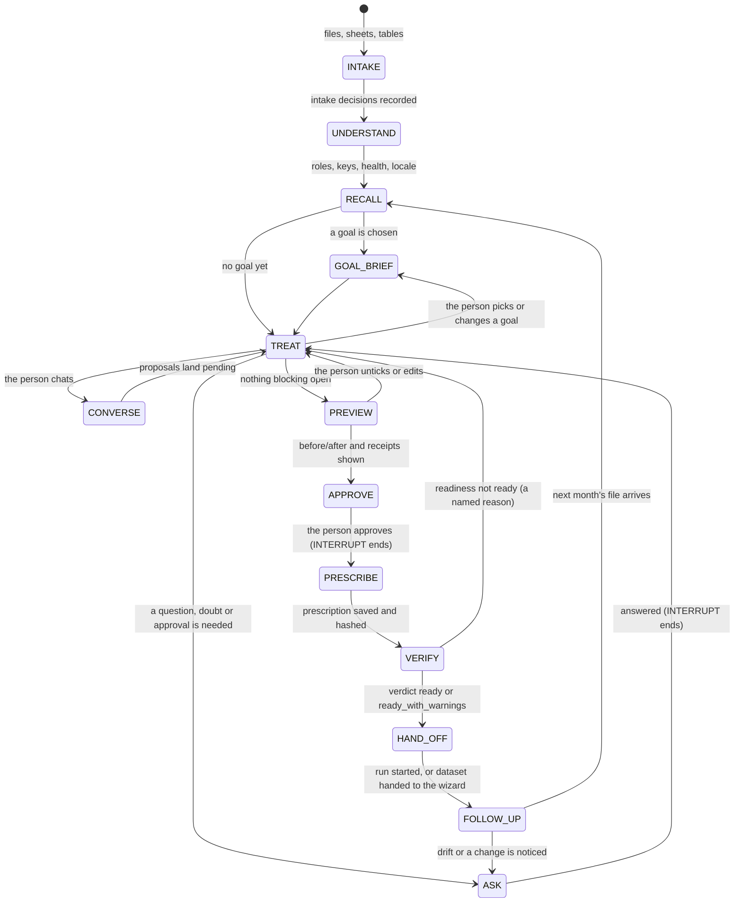

# Data Doctor: the one data agent (technical design)

**Companion to:** Plan O (`MARKETING_AI_PLAN_O_DATA_DOCTOR.md`, the build plan), Plan L
(`MARKETING_AI_PLAN_L_DATA_DOCTOR.md`, whose promises §5.2 this design keeps), Plan G (`docs/AGENTS.md`), Plan K
(`MARKETING_AI_PLAN_K_PROPOSAL.md`, `PLAN_K_TECHNICAL_DESIGN.md`), `docs/DATA_DOCTOR.md`, `PARALLEL_WORK_PROTOCOL.md`.
**Owner:** Minfy — AI/ML team
**Status:** design for approval, 12 October 2026. Nothing in it is built until Plan O is approved.

> **Evidence.** This design rests on five notes written on 12 October 2026 and on the repository itself.
> They are cited by short name:
>
> | Short name | What it is |
> |---|---|
> | **[REQ]** | The product owner's requirements for Data Doctor, nine points, binding |
> | **[INV]** | Inventory of every data capability in the code today, with file:line, overlaps, gaps and the top ten missing pieces |
> | **[RDY]** | What "ready for AutoML" means here. Every gate; the nine gaps where validation passes but a run fails; AUTO/ASK/APPROVE triage; a proposed readiness report |
> | **[RUN]** | Which agent runtime to reuse: Plan G's loop, Plan K's contracts, the visit state machine, the risks |
> | **[RES]** | External state of the art, design implications D1–D11, the pitch, the caveats |
>
> The notes are working papers. Every file:line below was taken from them and spot-checked in this branch.
> Figures marked **[S]** in [RES] come from search summaries, not primary pages.

---

## 1. The product

### 1.1 Data Doctor in five sentences

1. Data Doctor is one agent that takes whatever data a client has and returns one dataset that AutoML can train on.
2. It reads any mix of files, sheets and connected tables, understands them, fixes what rules can prove, and asks
   one clear question when they cannot.
3. Every capability the product has for data today is one of its tools, so there is one place to go and one
   conversation to have.
4. Nothing changes without the person's yes, every change is a named step that replays next month, and "ready"
   means the run will not fail for a data reason.
5. It knows Indian data first (Hinglish headers, ₹ and lakh, DD/MM dates, PAN, Aadhaar, GSTIN) and notices when a
   file holds something it does not know, such as dollars.

### 1.2 The pitch

> **"Send the exports you already have. Data Doctor makes them ready to train, asks only what it cannot
> prove, and prepares next month's file exactly the same way."**

The research's line ([RES] §4.3) is kept in spirit. "Ready to train" is added because readiness is what Plan O
newly guarantees (§10).

**Three proof points we can stand behind today.** Each is measured or demonstrable in this repository.

| # | Proof point | Source | Caveat to say aloud |
|---|---|---|---|
| P1 | 30 of 30 messy export shapes reached Approve with no manual setup, asking 0.33 questions per file. | `reports/plan_l_benchmark.md` (M160) | The data under the mess is generated. No non-technical person has been timed yet. |
| P2 | Every change is a step from a fixed list of 18 kinds, with a receipt (rows changed, values that failed). The AI never writes code and never ticks its own suggestions. Next month's file replays and stops when a column changed. | `engine/agent/contracts.py` `RecipeStepKind`; `docs/AGENTS.md` §6; `docs/DATA_DOCTOR.md` §8 | Demonstrable live; not a benchmark figure. |
| P3 | PAN, Aadhaar, phone, e-mail and UPI ids are masked before any prompt, and a canary test walks every tool on every build. Hinglish headers such as `kul_kharch` are read with 92.3% top-3 accuracy on held-out files. | `docs/AGENTS.md` §7.7 and §13.5; `tests/unit/agent/test_egress_canary.py` | The header cases were written by the lexicon's author. GSTIN and voter ID are not detected yet, so we do not say "every Indian ID". |

**Three proof points we will measure when Plan O is built.** None may be quoted before its report exists.

| # | Proof point | How it is measured | Milestone |
|---|---|---|---|
| P4 | Time from first file to first trained model, for a non-technical tester, on messy files | Timed sessions on the messy benchmark, five or more testers | M250 |
| P5 | Share of messy files made ready with no person beyond answering questions, and questions per file. The files include 20 Indian ones written by someone other than the lexicon's author. | The extended benchmark, rules-only and with the AI | M248 |
| P6 | Zero silent data loss, and every "ready" verdict followed by a run that does not fail for a data reason | Harm metrics on the benchmark; the readiness invariant checked on every benchmark run | M248 |

**What we will not claim** ([RES] §4.3): "cleans any file"; accuracy against a named competitor; "DPDP-compliant" as
a product property. We may say "built to support DPDP obligations: masking, minimisation, a one-year processing log".

---

## 2. Why one agent

Today the same job is done in several places ([INV] "Overlaps"):

- six data-entry screens (`#/doctor`, `#/data`, the Guided setup tab, Manual setup's builder, the connection picker, Simple UI links);
- three role vocabularies, three column-name normalisers, two value-cleaning engines;
- leak detection in five places and **seven separate readiness verdicts** ([INV] §5);
- two memory and replay systems that do not know each other;
- three proposal and approval models: Plan G `Proposal`, Plan K proposals with ledger, model approvals.

Three runtimes already exist ([RUN] "Bottom line"). Plan G's loop works on data. Plan K's registry, policy and ledger
govern but touch no data. Plan L's Doctor functions diagnose several files but keep no state (DEC-1513).

**The decision.** One agent, Data Doctor, whose tools are every one of those capabilities. Plan G's session and
loop become its runtime. Plan K's contracts sit underneath. Plan K's state machine with an INTERRUPT becomes the
outer *visit* ([RUN] "Proposed architecture"). This satisfies [REQ] 1 ("all the features as its tools") and [REQ] 4
("if we need to build more tools we can").

---

## 3. One agent, two modes

### 3.1 Without a goal

The person drops files without choosing anything. Data Doctor:

1. reads every file and sheet (intake rules, [INV] 1.1–1.2);
2. understands each file: what it is, its key, its dates, its health ([INV] 2.3, 2.9);
3. fixes general problems that do not depend on a goal: formats, placeholders, footers, spellings, units, keys;
4. says what the data **can power**, per goal, as *Ready*, *Ready after fixes*, *Not enough data yet* or
   *Missing something* (today's `engine/doctor/diagnose.py:153` `readiness`);
5. says what is **missing** for the other goals, with who usually has it (`engine/doctor/sufficiency.py:125`,
   `engine/pilot/data_request.py`).

General fixes never touch what a goal would decide: the outcome, the split, consent mapping, leak keep or hide.

### 3.2 With a goal brief

A **goal brief** is a frozen, hashed object derived from a use case's configuration by `load_goal_brief`. It is not
written by the AI. Its fields:

| Field | From | Example |
|---|---|---|
| `goal_id`, `goal_name`, `problem_type` | use-case YAML; Plan M §4.2 names | `retail_win_back`, "Win back lapsed customers", `binary` |
| `outcome` | `target.column`, `agent.column_hints.target_synonyms`, `positive_label`; the success sentence in `configs/outcomes.yaml` | "A customer is won back when they order within 30 days of the offer" |
| `time_rules` | `split.type`, `split.time_column`, snapshot column, outcome window, maturity | split by `snapshot_date`; 30-day window; label must be mature |
| `required_columns` | primary-key hints; consent, opt-out, last-contact; treatment; `value_column`; channel columns; `complaint_text`; copy `allowed_fields` | consent + opt-out required for a contacting goal |
| `split` | `split.*` with fractions and group column | time-based, 0.2 validation, 0.2 test |
| `thresholds` | `validation.min_rows`, `min_positive`, uplift `min_arm_rows` | 1,000 rows, 200 positives |
| `levels` | `agent.levels` | `[clean, derive, reshape]` |
| `value_consent_channel` | `actions.suppression.channels`, value per conversion | WhatsApp and SMS consent per channel |
| `time_settings` | §3.5: the training budget, and the data time settings (as-of date, cut points, outcome window, lapse, snapshot cadence) | Balanced, about 15 minutes; as of `snapshot_date`; 90-day window; month-end snapshots |
| `mode` | train, score, measure outcomes, audit | train |
| `brief_hash` | sha256 of the fields above | used in the prescription and the readiness report |

The brief drives goal-specific work:

- the checks of [RDY] §1.2–§1.11 that apply to that `use_case_type`;
- goal questions: which value means "yes", which date splits, is this column consent;
- the readiness checklist and its verdict (§10).

### 3.3 The seamless switch

- **Start generic, pick a goal, continue.** Choosing a goal adds a brief to the same case. Nothing decided is
  re-asked. The general part of the prescription is kept. Goal items are added below it.
- **Several goals, one case.** A case may hold several briefs. The prescription has one shared base and one
  section per goal (§9). Switching the active goal sets the other goal's section aside; it is not deleted.
- **Same memory.** Remembered answers (§7) and treatments (`engine/doctor/memory.py`) are per client, so they apply
  in both modes.
- **Entered from a goal.** The wizard's Customers step and a goal's setup open the same case with the brief already
  set (§13).

### 3.4 The visit

The visit is a persisted state machine, copied from Plan K's planner pattern (`engine/agentic/planner.py`: one step
per transition, saved after each, resumable, idempotent; [RUN] "Planner"). INTERRUPT means "waiting for the person".



| State | What happens | AI allowed? |
|---|---|---|
| INTAKE | Intake rules per file and sheet; encoding, delimiter, header row, footer rows, missing words; parser row loss | No |
| UNDERSTAND | Profile; file role; key; dates; Hinglish headers; locale detection; how files fit; first look | Optional: second opinion (rerank), `explain` |
| RECALL | Same-shape treatments and remembered answers for this client; renamed columns | No |
| GOAL_BRIEF | `load_goal_brief`; goal checks queued | No |
| TREAT | The rules' proposals, questions and stops; AI proposals land pending | Yes, proposals only |
| ASK | One question, a doubt or an approval request is open | Optional: wording of a doubt |
| CONVERSE | Plan G's JSON-action loop, one bounded state ([RUN]) | Yes |
| PREVIEW | `run_recipe` on 1,000 rows or entities; build preview; receipts | No |
| APPROVE | The person approves; APPROVE-class items need their own confirmation (§6.6) | No |
| PRESCRIBE | Prescription saved, hashed, remembered per client | No |
| VERIFY | `DataReadinessReport` on the prepared copy, with every X-probe | No |
| HAND_OFF | `POST /runs`, `POST /uplift/runs`, or the wizard's next step | No |
| FOLLOW_UP | Replay on next month's file; drift check; run checks after training; actual against expected training time | No |

With no AI service connected, every state completes. Only CONVERSE, the second opinion and `explain` are unavailable
([REQ] 9; Plan L §5.2.7).

### 3.5 Time settings, owned by Data Doctor

Nobody should have to guess how long training takes or which dates to use ([REQ] 10). Time settings are part of
the goal brief. They are detected, proposed with a reason, asked when unsure, and remembered per client.

**(a) The training time budget.** Today `engine/agent/recommend.py:317-341` (`_time_rules`) only shortens the
search for a small file or lengthens it for a large one. The default is 30 minutes (`configs/engine.yaml:118`;
10 for uplift, `:322`).

| Step | What happens |
|---|---|
| Predict | `estimate_training_time` predicts minutes from rows × columns × the model families the goal allows × this deployment's past runs. Its source is the same stored stage durations M189's progress estimate reads (`engine/pipeline.py:353-370`, `:705` `record_stage_duration`). With no history, it uses the public library's runs as a prior and says so. |
| Recommend | `propose_training_budget` finds the point of diminishing returns. That is the budget after which similar past runs gained less than a set score step per extra minute. |
| Present | Three choices, never a raw minutes field: **Quick** (about N minutes), **Balanced** (about N minutes, recommended), **Thorough** (about N minutes). Each says what it buys: "Thorough has found a better model on 2 of 9 similar past runs". |
| Promise | The chosen budget and the expected time are shown before the run starts. The same expectation drives M189's progress bar and ETA, so the screen and the promise agree. |
| Learn | After the run, FOLLOW-UP records actual against expected per stage. The next estimate uses it. |

The budget sets `model_search.time_limit_minutes` within its range (1–240). It is a setting, not an APPROVE-class
item. Balanced is pre-selected when the history is close in size (`sure`); otherwise it is `check`. An analyst may
still set exact minutes under Settings → Advanced with technical details on (Plan M, M3); Data Doctor shows that as
"Custom".

**(b) Data time settings.** `propose_time_settings` proposes each of these from the data, with a reason:

| Setting | Detected from | Asked when |
|---|---|---|
| As-of date (the date each row describes) | `find_time_columns`, header reading (`docs/AGENTS.md` §13.3), `describe_dates` | two columns could be it |
| Time-split cut points | at least 3 distinct dates (`advisor.py:132`); no tie block empties a part (`prepare.py:1143-1184`); validation and test fractions | the feasible cuts leave a part too small for the goal's thresholds |
| Newest slice mature | the outcome window must end before the file's latest date (`X_LABEL_MATURITY`) | always, when the newest month is immature: "Your newest month's outcomes are not final yet. Leave it out of testing?" |
| Outcome window | the goal's choices in `configs/outcomes.yaml` (30, 60, 90 days), with counts per choice (`offer_outcome`) | always: it is part of the outcome definition (APPROVE-class) |
| Lapse definition | `engine/agent/label_drafts.py:83` drafts with grace | always, as a sentence to agree (APPROVE-class) |
| Snapshot cadence | event-date density; `engine/onboarding/snapshots.py:66` `plan_snapshots` | weekly and monthly would both leave enough snapshots and change the row count materially |

The as-of date, cut points, maturity choice and cadence become standing answers per client (§7.2). The outcome window
and the lapse definition are part of the outcome definition, so they are saved in the prescription and offered
again, but asked again when the evidence changes. The readiness probes `X_TIME_ALL_PARSE`, `X_TIME_CUTS_FEASIBLE` and
`X_LABEL_MATURITY` check the chosen settings on the prepared copy (§10.2).

---

## 4. The case

### 4.1 What a case holds

A **case** is one persistent object per piece of work. It replaces today's one-upload Guided session
(`uploads/<id>/agent/agent_session.json`), the stateless Doctor diagnosis (DEC-1513) and the in-browser hand-off
(`ui/modules/doctor/handoff.js`) ([INV] "Top 10" item 1).

| Part | Holds |
|---|---|
| Identity | `case_id`, `client_id`, `created_by` (user id), `created_at`, `state` (visit state), `version` |
| Files | per file: `upload_id`, original upload, sheet, `IntakeSpec`, role, key, fingerprint, `connection_ref` |
| Diagnosis | per file and across files: roles, health findings, links (`how_files_fit`), stacks, first looks |
| Locale profile | §8; detected, then confirmed once |
| Goal briefs | zero or more, one active (§3.2) |
| Items | every proposal: id, kind, source (`rules`, `ai`, `person`), confidence (`sure`, `check`), state, evidence ids, `payload_digest` |
| Questions, doubts | open and answered, with the option chosen and who chose it |
| Approvals | APPROVE-class decisions with user id, exact text shown, time, receipt id |
| Remembered answers used | which standing answers were applied (§7), each revocable |
| Chat | masked transcript and `sent` records ("What the AI looked at", `docs/AGENTS.md` §7.7) |
| Evidence | tool results keyed by content-hash evidence id |
| Timeline | append-only events: state changes, decisions, previews, approvals, hand-offs, replays |
| Prescription | the hash of the approved prescription and of earlier versions (§9) |
| Readiness | the latest `DataReadinessReport` per goal (§10) |
| Counters | model calls, tool calls, cost per visit, questions asked per file, expected and actual training time |

### 4.2 Storage

- `cases/<client_id>/<case_id>/case.json`, written atomically with a version check. A second writer gets
  `409 CASE_VERSION_CONFLICT`. This replaces the per-process thread lock noted in `docs/AGENTS.md` §11.
- `cases/<client_id>/<case_id>/timeline.jsonl`, append-only.
- `cases/<client_id>/<case_id>/evidence/<evidence_id>.json`, tool results.
- `cases/<client_id>/<case_id>/prescriptions/<hash>.json` and `readiness/<goal_id>_<hash>.json`.
- Files stay where uploads live today. The case refers to them by `upload_id`; it never copies cells.

### 4.3 Per-client scope

Every case, memory entry and remembered answer carries `client_id`. A tool's context is bound to one case, so a
tool cannot read another client's files. A single-tenant deployment uses the client `default`. This closes [INV]
gap 16 for Data Doctor's own stores. Upload isolation itself stays with `docs/CLIENT_ISOLATION.md`.

### 4.4 Retention and erasure

- `cases` becomes a store in `engine/privacy/layout.py`, beside `doctor_memory`.
- Erasing an upload removes its file entry and its evidence, and marks prescriptions that read it as `orphaned`.
- An erasure request for a person removes `correct_cells` entries and remembered answers holding their id, as
  `engine/privacy/erasure.py:121/:207` does for memory today.
- Data follows the shortest retention of its uploads. The **processing log** (timeline, decisions, receipts,
  prescriptions without cell values) is kept for `privacy.processing_log_days`, default 365. DPDP Rule 8(3) asks
  for at least one year ([RES] §4.2, D10).

---

## 5. The tool registry

### 5.1 Kinds

| Kind | Does | Who may call |
|---|---|---|
| **READ** | Looks; returns evidence; changes nothing | rules, the AI, the screen |
| **PROPOSE** | Adds a pending item to the case: a step, a setting, a role, a mapping, a build, an outcome definition | rules, the AI, the person |
| **ASK** | Opens a question, a doubt, an approval request or a data request | rules, the AI |

**APPLY is never a tool.** Only two executors change data, and both are bound to an approved prescription:
`apply_prescription` (today `api/routes/agent.py:1147`) and `replay_prescription` (today
`api/routes/agent_recipes.py:368`, `engine/agent/dataset_recipe.py:223`). This keeps Plan L's promise 1 and Plan K's
invariant I1 ([RUN] "Proposed architecture").

### 5.2 One registry, one context

- **Types.** Plan G and Plan K both define `ToolKind`, `ToolResult`, `Proposal` and `ProposalKind` with different
  meanings ([RUN] conflict 1). The registry lives in `engine/doctor/registry.py` and imports Plan K's `AgentTool`
  shape (`engine/agentic/registry.py:135`). The Plan G names are re-exported under a `data_` prefix until callers move.
- **`DataToolContext`** = Plan G's `AgentContext` (frame, profile, config; `engine/agent/tools.py:141-166`) + Plan K's
  `principal`, `storage`, optional `ledger` (`engine/agentic/registry.py:86-103`) + the case + the `Egress` gate.
- **Role per call.** Every tool has a `RoutePolicy`. A Viewer may call READ tools only. This moves Plan G's
  route-level check into each call, as Plan K does (`registry.py:199-255`).
- **Content-hash evidence ids.** `evidence_id = sha256(tool, typed arguments, output)` (Plan K
  `evidence_id_for`, `registry.py:129`). Plan G's counter ids block pass^k ([RUN] conflict 2); they are retired.
- **Results.** At most 5,500 characters of JSON for row-level tools (Plan G) and 16 KB of aggregates for others
  (Plan K). Cell-derived text sits only under non-`SAFE_KEYS` keys, so the egress gate masks it by default.

### 5.3 Exposure

| Exposure | Meaning | Which tools |
|---|---|---|
| `session-only` | Callable inside a case by rules, the AI and the screen. **Never listed on MCP.** | Every tool that returns a cell, a row or a masked example |
| `aggregate` | May be listed on MCP later, through Plan K's gate | Counts and verdicts only: `check_readiness`'s verdict, `what_can_this_power` |

Plan O lists **no** Data Doctor tool on MCP (decision O7). Row-level data never leaves through MCP ([RUN] conflict 3).

### 5.4 Adding a tool

A new tool is a registry entry, a `RoutePolicy`, golden fixtures, an egress canary entry and, for PROPOSE, a policy
rule set. Default deny forces the rule set: a PROPOSE tool without one is refused with `POLICY_NO_RULES`
(`engine/agentic/policy.py:541`). The mutation test proves each rule matters ([RUN]; `engine/agentic/evals.py:345`).
This answers [REQ] 4: adding a tool is cheap, and it cannot be added unsafely.

### 5.5 The tool catalogue

**Status** is one of three. *Existing*: a tool registered today in Plan G's `TOOLS` (`engine/agent/tools.py:1744`)
or an action of its loop, moved into the registry as it is. *Wrapper*: the function exists today but is not a tool;
the registry wraps it. *New*: the logic does not exist. **Mode** is *rules* (deterministic) or *AI*; "rules + AI"
means the rules propose and the AI may also propose, always pending.

#### A. Reading and intake ([INV] §1)

| # | Tool | Kind | Mode | Wraps (file:line) | Status |
|---|---|---|---|---|---|
| 1 | `read_file` | READ | rules | `engine/intake/run.py:162` `intake_file`, `:689` `notes_for`; `engine/stages/ingest.py:291/:315/:377` encoding and delimiter | wrapper |
| 2 | `list_sheets` | READ | rules | `engine/intake/excel.py:62/:177`; `run.py:493` | wrapper |
| 3 | `propose_intake` | PROPOSE | rules | intake decisions of `intake_file`, frozen as an `IntakeSpec` that replays (today they re-run, DEC-1501g) | wrapper |
| 4 | `read_other_format` | READ | rules | JSON, JSONL, a `.gz` or `.zip` holding one table ([INV] gap 1) | new |
| 5 | `check_parser_loss` | READ | rules | physical lines vs parsed rows; `ingest.py:492` drops malformed lines with a warning ([RDY] §1.1) | new |
| 6 | `preview_connection` | READ | rules | `api/routes/connections.py:246-419` browse and masked preview; `engine/connections/*` | wrapper |
| 7 | `propose_import` | PROPOSE | rules + AI | the connection import route; connection-backed sources `engine/onboarding/sources.py:308` | wrapper |
| 8 | `check_refresh` | READ | rules | `engine/onboarding/sources.py:634/:776`; `engine/scheduling/firing.py:616` | wrapper |
| 9 | `preflight` | READ | rules | `engine/pilot/preflight.py` (folded into `check_readiness` at switch-over) | wrapper |
| 10 | `diagnose_files` | READ | rules | `engine/doctor/diagnose.py:82` `diagnose_file`; the ≤ 20 files and 4M rows caps of the Doctor route | wrapper |

Uploads (`api/routes/uploads.py:116/:123/:182`) stay a **person entry point**, not a tool. The agent's side of it is
`request_data` (#70). The measurement pull (`engine/measurement/pull.py:225/:325`) is not a preparation tool; its
contracts are read by `check_readiness` in mode `measure_outcomes` ([RDY] §3).

#### B. Looking ([INV] §2.1–2.2: Plan G's 18 look tools, unchanged)

All 18 are *existing*, READ, rules, `session-only`, and keep their limits (`docs/AGENTS.md` §3).

| # | Tool | # | Tool | # | Tool |
|---|---|---|---|---|---|
| 11 | `get_profile` | 17 | `find_roles` | 23 | `describe_numbers` |
| 12 | `inspect_column` | 18 | `draft_outcome_labels` | 24 | `describe_dates` |
| 13 | `find_format_issues` | 19 | `check_data` (`engine/agent/checks.py:20` `check_plan`) | 25 | `compare_columns` |
| 14 | `describe_placeholder_values` | 20 | `sample_rows` | 26 | `describe_missing` |
| 15 | `describe_outcome` | 21 | `value_counts` | 27 | `rate_by` |
| 16 | `describe_repeats` | 22 | `find_values` | 28 | `describe_duplicates` |

#### C. Understanding ([INV] §2.3–2.15)

| # | Tool | Kind | Mode | Wraps (file:line) | Status |
|---|---|---|---|---|---|
| 29 | `find_file_role` | READ | rules | `engine/onboarding/sources.py:305` `detect_roles`, `:360/:135/:200`; `configs/roles.yaml` | wrapper |
| 30 | `read_headers` | READ | rules | `engine/agent/headers.py:252/:405`; `configs/agent/header_lexicon.yaml` (on by default, O4) | wrapper |
| 31 | `second_opinion` | PROPOSE | AI | `engine/agent/assist.py:365` (rerank, leak reviewer) | wrapper |
| 32 | `advise` | READ | rules | `engine/agent/advisor.py:1422` `advise`; `recommend.py:538/:422`; `STOP_CODES` | wrapper |
| 33 | `first_look` | READ | rules | `engine/doctor/first_look.py:308/:430/:550` | wrapper |
| 34 | `how_files_fit` | READ | rules | `engine/doctor/joins.py:85/:111/:272` | wrapper |
| 35 | `load_goal_brief` | READ | rules | use-case YAML through `UseCaseConfig`; `configs/outcomes.yaml`; `configs/engine.yaml` | new |
| 36 | `what_can_this_power` | READ | rules | `engine/doctor/diagnose.py:153` `readiness` | wrapper |
| 37 | `enough_data` | READ | rules | `engine/doctor/sufficiency.py:125/:155` | wrapper |
| 38 | `data_request` | READ | rules | `engine/pilot/data_request.py`; `configs/pilot/data_request.yaml` | wrapper |
| 39 | `explain` | READ | AI | the claims renderer `engine/agentic/claims.py:756/:805` with new data claim types (count, share, rate by group, "changed N of M rows") | new |
| 40 | `find_time_columns` | READ | rules | one rule over `ingest` profile, `describe_dates`, `formats.py:431` `date_order`, `recommend.py:538`, the builder's `event_time` ([INV] 2.12) | wrapper |

Column-name normalising ([INV] 2.15: `engine/column_names.py:110`, intake naming, egress aliases) is a library every
tool uses, not a tool. Plan O keeps `column_names.py` as the one normaliser.

#### D. Roles, keys, mapping and the outcome ([INV] §2.4, 2.7, 2.13, 2.14)

| # | Tool | Kind | Mode | Wraps (file:line) | Status |
|---|---|---|---|---|---|
| 41 | `propose_role` | PROPOSE | rules + AI | `detect_roles` (#29); Plan L §5.3 (not built, DEC-1579) | wrapper |
| 42 | `propose_key` | PROPOSE | rules | one key rule over ingest candidates, `advisor.py:323/:414`, `describe_repeats`, the builder's `ENTITY_DUPLICATE_KEYS`, the Doctor `id_column` | wrapper |
| 43 | `propose_mapping` | PROPOSE | rules + AI | `engine/onboarding/mapping.py:378/:569/:691` (≥ 85% auto, 50–85% suggested; value maps) | wrapper |
| 44 | `propose_setting` | PROPOSE | rules + AI | `engine/agent/loop.py:593-637`; `setting_allowed`; `resolve_config` | existing |
| 45 | `define_outcome` | PROPOSE (APPROVE) | rules; AI drafts the sentence | `engine/onboarding/labels.py:464` `build_labels` (presence, absence, value threshold, grace, exclude, censoring); `engine/doctor/outcomes.py:531` `offer_outcome`; `engine/agent/label_drafts.py:83` | new |
| 46 | `map_outcome_values` | PROPOSE (APPROVE) | rules + AI | `engine/stages/validate.py:712` positive-label rule; `TARGET_NOT_BINARY` `:1009` | new |
| 47 | `check_target_type` | READ | rules | `validate.py:1009` (`switch_to=regression`); [RDY] §1.5 gap: nothing checks a regression target is numeric | new |

#### E. Fixing: the step vocabulary ([INV] §3)

| # | Tool | Kind | Mode | Wraps (file:line) | Status |
|---|---|---|---|---|---|
| 48 | `propose_step` | PROPOSE | rules + AI | `engine/agent/loop.py:655-784`; `engine/agent/recipe.py:172` `check_recipe`, `:608` `run_recipe` | existing |
| 49 | `edit_by_hand` | PROPOSE | person only | `engine/agent/edits.py:86/:227`; `api/routes/agent.py:788/:760` | existing |
| 50 | `propose_renamed_copy` | PROPOSE | rules | `engine/doctor/renames.py:333/:465`; `api/routes/agent_renames.py:150/:259/:398` (extended to built datasets and added columns) | wrapper |
| 51 | `synonym_clusters` | READ | rules (+ AI) | groups spellings by case, punctuation, known abbreviations, the Hinglish lexicon and a frozen edit-distance rule; emits `map_values` proposals | new |
| 52 | `impossible_values` | READ | rules | `engine/agent/value_steps.py:97` `valid_range`; new rules: future dates, negative tenure or amount, year 2099, age over 120 | new |
| 53 | `detect_units` | READ | rules | unit words in values (`GB`, `MB`, `L`, `Cr`, currency tokens `formats.py:70`); proposes `convert_units` (`value_steps.py:116`) | new |
| 54 | `keep_latest_per_id` | PROPOSE | rules | new entity-wise step, point-in-time like `engine/agent/reshape.py:347/:753` | new |
| 55 | `normalise_key` | PROPOSE | rules | builder transforms `engine/onboarding/transforms.py:130/:255/:302` (strip, `lstrip_zeros`); the tidy-ups `joins.py:111` names; `KEY_FORMAT_MISMATCH` | new |

`propose_step` carries the whole step vocabulary. The table below is that vocabulary. Every kind stays stateless
(DEC-1004) and refused on the ID and the outcome (Plan L §5.2.3 and §5.2.6).

| Step kind | Level | Proposed by | Status |
|---|---|---|---|
| `parse_number` (`formats.py:322`) | clean | rules (sure ≥ 95%), AI | existing; **new params** `indian_scale_words`, `unit` (§8) |
| `parse_date` (`formats.py:499`) | clean | rules (order proven), AI | existing |
| `map_boolean` (`formats.py:549`) | clean | rules, AI | existing; **new spellings** `haan/nahi`, `ha/na`, `हाँ/नहीं` (§8) |
| `normalise_text` (`formats.py:617`) | clean | rules | existing |
| `set_missing` (`placeholders.py:133`) | clean | rules, never ticked | existing |
| `valid_range` (`value_steps.py:97`) | clean | rules, never ticked; AI; person | existing |
| `map_values` (`value_steps.py:64`) | clean | rules, AI, person | existing |
| `set_missing_text` (`value_steps.py:89`) | clean | intake rule, AI | existing |
| `convert_units` (`value_steps.py:116`) | clean | AI, rules verify | existing |
| `split_column` (`value_steps.py:158`) | derive | AI, person | existing |
| `fill_missing` constant (`value_steps.py:181`) | clean | AI, person | existing |
| `correct_cells` (`value_steps.py:191`) | clean | person only | existing |
| `remove_rows` (`value_steps.py:225`; Plan L's `filter_rows`) | derive | person only | existing |
| `rename_column`, `drop_column` | clean | person, AI | existing |
| `derive` (`onboarding/transforms.py:508`) | derive | person; not proposed by rules today | existing |
| `combine_rows` (`reshape.py:347`) | reshape | rules (blocking question) | existing |
| `unpivot` (`unpivot.py:359/:454`) | reshape | rules (blocking question) | existing |
| `normalise_key` | clean | rules | **new** |
| `keep_latest_per_id` | reshape | rules (blocking question) | **new** |
| `convert_currency` | clean | rules; rate from the person (APPROVE) | **new** |

The builder's own transforms (`cast`, `value_map`, `scale`, `strip`, `lower`, `lstrip_zeros`, `negate`, `derive`,
`dedupe`; [INV] §3 "Other paths") stay inside the build spec. `propose_mapping` and `normalise_key` propose them;
they are not a second cleaning engine for single files.

#### F. Several files ([INV] §3, gaps 2–3; top 10 items 2 and 4)

| # | Tool | Kind | Mode | Wraps (file:line) | Status |
|---|---|---|---|---|---|
| 56 | `join_files` | PROPOSE | rules | `engine/onboarding/sources.py:416/:471` `join_coverage`; the builder's entity + event join; adds per-customer file to per-customer file and outcome lists | new |
| 57 | `stack_files` | PROPOSE | rules | `engine/onboarding/build.py:463` `pd.concat`; `joins.py:272` `file_stacks`; adds de-duplication of overlapping exports | new |
| 58 | `build_dataset` | PROPOSE | rules | `engine/onboarding/build.py:1060`; `features.py:361/:434/:168`; `snapshots.py:66`; the build report `onboarding/validate.py:869` | wrapper |
| 59 | `split_file` | PROPOSE | rules | Plan L §5.5: one file into a training file and a scoring file by a rule, one recipe | new |

`build_dataset` lets Data Doctor drive the builder, closing DEC-1550 and DEC-1578.

#### G. Locale, currency and Indian formats ([REQ] 7; [RES] D3)

| # | Tool | Kind | Mode | Wraps (file:line) | Status |
|---|---|---|---|---|---|
| 60 | `detect_locale` | READ | rules | `formats.py:431` `date_order`; `formats.py:70` `CURRENCY_TOKENS`; decimal-mark proof in `find_format_issues`; phone and ID shapes | new |
| 61 | `parse_indian_numbers` | PROPOSE | rules | `parse_number` with `indian_scale_words`: `L`, `lac`, `lakh` = 10⁵; `Cr`, `crore` = 10⁷; `K` = 10³; a trailing `/-` | new |
| 62 | `indian_booleans` | PROPOSE | rules | `map_boolean` with Hindi and Hinglish spellings; `sure` only when both sides are seen | new |
| 63 | `detect_india_ids` | READ | rules | `engine/pii.py:265/:327`; adds GSTIN (checksum), EPIC (voter ID), PIN code as 6-digit text, phone to `+91` E.164 for exact keys | new |
| 64 | `convert_currency` | PROPOSE (APPROVE) | rules | new step; frozen dated rate from the person (§8.2) | new |
| 65 | `find_personal_data` | READ | rules | `engine/pii.py:265/:327/:349` `detect_pii`, `free_text_pii`, `redact_text` | wrapper |

#### H. Safety and governance checks ([INV] §4)

| # | Tool | Kind | Mode | Wraps (file:line) | Status |
|---|---|---|---|---|---|
| 66 | `check_leaks` | READ | rules (+ AI reviewer) | `validate.py:1833/:1840/:1675/:1738` `LEAKAGE_SUSPECTED`; `onboarding/validate.py:831` `FUTURE_EVENTS_LEAKED`; `:717` time-versioning warning; `build.py:557/:820`; the first-look exclusion; the leak reviewer in `assist.py` | wrapper |
| 67 | `map_consent` | PROPOSE (APPROVE) | rules | `engine/privacy/consent.py:221/:795`; `validate.py:1440/:1467`; `engine/decide/channel_columns.py:73-83`; consent vocabulary and direction, per channel ([RDY] gap 4; [RES] D4) | new |
| 68 | `check_uplift_data` | READ | rules | `engine/uplift/checks.py:814-1015`; `engine/uplift/data.py:100-240` | wrapper |

#### I. Readiness, memory and follow-up ([INV] §5–6)

| # | Tool | Kind | Mode | Wraps (file:line) | Status |
|---|---|---|---|---|---|
| 69 | `check_readiness` | READ | rules | `check_plan` (`checks.py:20`); uplift checks; the X-probes; the build report; `engine/pilot/readiness.py:424`; `prepare.py:229` and `:1031` simulated | new |
| 70 | `request_data` | ASK | rules + AI | `sufficiency.py` `next_steps`; `data_request` (#38) | new |
| 71 | `recall_treatment` | READ | rules | `engine/doctor/memory.py:176/:231` `recall`, `offer_for` (per client) | wrapper |
| 72 | `drift_check` | READ | rules | the recipe contract learnt at approval ([RES] D1); new | new |
| 73 | `read_run_checks` | READ | rules | `engine/run_checks.py:231`; `engine/model_gates.py:244/:123` `RESULT_SUSPICIOUSLY_GOOD` | wrapper |

#### J. Asking

| # | Tool | Kind | Mode | Wraps (file:line) | Status |
|---|---|---|---|---|---|
| 74 | `ask_question` | ASK | rules + AI | `Question` and `QuestionOption` (`engine/agent/contracts.py:405/:415`); `session.answer` (`session.py:475`); Plan G's `ToolKind.ASK` exists but is unused ([RUN]) | new |
| 75 | `express_doubt` | ASK | rules + AI | §6.7 | new |
| 76 | `request_approval` | ASK | rules | `engine/approvals.py:481` `ProposalReceipt`, `:510` `decide_proposal` (separation of duties, expiry) | wrapper |

#### K. The conversation ([INV] §7)

| # | Tool | Kind | Mode | Wraps (file:line) | Status |
|---|---|---|---|---|---|
| 77 | `chat_turn` (CONVERSE) | — (the loop that calls tools) | AI | `engine/agent/loop.py:331-546` | existing |
| 78 | `ask_your_data` (CONVERSE, read-only) | — | AI | `engine/agent/explore.py:57/:149`; now also on the prepared copy before training | existing |

#### L. Time settings ([REQ] 10; §3.5)

| # | Tool | Kind | Mode | Wraps (file:line) | Status |
|---|---|---|---|---|---|
| 79 | `estimate_training_time` | READ | rules | stored stage durations `engine/pipeline.py:353-370/:705`; M189's progress estimate; `configs/engine.yaml:118/:322` | new |
| 80 | `propose_training_budget` | PROPOSE | rules | `engine/agent/recommend.py:317-341` `_time_rules` (replaced); `model_search.time_limit_minutes` | new |
| 81 | `propose_time_settings` | PROPOSE | rules | `recommend.py:538`; `advisor.py:132`; `prepare.py:1143-1184`; `snapshots.py:66`; `label_drafts.py:83`; `configs/outcomes.yaml` | new |

#### M. Added with Plan O M236 (DEC-1806)

M240 built two READ tools in wave 1 that had no row. They are numbered after #81 so no other number changes.

| # | Tool | Kind | Mode | Wraps (file:line) | Status |
|---|---|---|---|---|---|
| 82 | `read_workbook_sheets` | READ | rules | `engine/intake/sheets.py` `split_workbook`: each sheet with a table becomes a file of the case (the workbook is kept; no value changes) | new |
| 83 | `find_excel_serial_dates` | READ | rules | `engine/agent/formats.py` `find_excel_serial_dates`: Excel day numbers, proposed as pending `parse_date` steps with `excel_serial` (M233's `data.excel_serial_dates`) | new |

#### Catalogue size

| Status | Count | Tools |
|---|---|---|
| Existing | 22 | the 18 look tools, `propose_setting`, `propose_step`, `edit_by_hand`, and the CONVERSE loop (counted once; `ask_your_data` is its read-only mode) |
| Wrapper | 29 | #1–3, #6–10, #29–34, #36–38, #40–43, #50, #58, #65, #66, #68, #71, #73, #76 |
| New | 31 | #4, #5, #35, #39, #45–47, #51–57, #59–64, #67, #69, #70, #72, #74, #75, #79–83. Inside `propose_step` they add 3 step kinds and 3 parameter extensions (counted with #54, #55, #61, #62, #64). |
| **Total** | **82 tools** | 24 PROPOSE and 4 ASK; the rest READ or the conversation loop (80 in the design as approved; #82 and #83 added with M236) |

The executors that change data (`apply_prescription`, `replay_prescription`, the builder's `build` and `replay`
(`engine/onboarding/replay.py:101`), `memory.remember` (`memory.py:144`)) are not in the catalogue on purpose.

---

## 6. The planner, and the ask / approve / doubt protocol

### 6.1 Rules first

The planner is deterministic. In each state it runs the rules (§3.4 table), records evidence and decides one of
four things for every finding:

| Decision | When ([RES] §3.2; [RDY] §4) | Example |
|---|---|---|
| **AUTO** | The values prove the answer | 2,998 of 3,000 values convert; a value over 12 proves day-first |
| **ASK** | The values cannot prove it, the options change the data materially, and one atomic question settles it | day or month first, with both readings valid |
| **APPROVE** | The answer changes meaning, governance or a safeguard, however sure the rules are | the outcome definition, keeping a leak |
| **STOP** | No choice makes the data usable | too few rows, no outcome, an ID that repeats with no date |

A STOP always carries what to do instead and what to collect (Plan L §5.7; `sufficiency.py`).

### 6.2 Where the AI is used, and where it is never used

| The AI may | The AI never |
|---|---|
| Propose a step, role, mapping, outcome sentence, synonym merge or setting: pending, `check`, never ticked | Decide AUTO, tick, approve, or move an item out of `pending` |
| Rerank candidates the rules already listed (`headers.reorder_within`) | Add a candidate the rules did not list |
| Word a question, a doubt or an explanation, through `numbers_grounded`, the guardrails and the claims verifier | Compute a number shown as a fact |
| Converse in CONVERSE, with read tools | Run at INTAKE, RECALL, PREVIEW, APPROVE, PRESCRIBE, VERIFY, HAND_OFF or replay |
| Ask a question when the rules cannot decide | Run at scoring, ever (no AI in replay) |
| Express a doubt | Write code, SQL, or a free expression (zero-code rule, [RES] D8) |

### 6.3 Budgets and bounds

| Bound | Default | Source |
|---|---|---|
| Model calls per visit | 60 (Plan G's 40 per session, plus multi-file work) | `agent.max_llm_calls_per_session` |
| Tool steps per chat turn | 12 | `agent.max_tool_steps_per_turn` |
| Cost per visit | metered by `Meter`; a per-visit cap in the configured currency | `engine/generative/budget.py:161`; Bedrock cost must stop returning `None` (`engine/llm.py:1062`) |
| Questions per file | 3 on average; at most `ceil(2.5 × ambiguities)`, capped at 10 per file | Plan L §11; PrepBench budget rule ([RES] §2.1, [O]) |
| Share of rows an AI step may change | warn above 30% of a column; refuse above 60% unless the person re-proposes it as their own edit | Plan L §7 `agent.max_ai_step_change_pct`, not built ([INV] §7) |
| Prompt size | 60,000 characters | `docs/AGENTS.md` §7.4 |

### 6.4 Determinism

- Rules are deterministic, so pass^k equals pass^1 for them.
- **Cached AI proposals.** An AI proposal is stored under `(evidence digest, prompt version, model id)`. Reloading a
  case shows the same suggestions ([RES] D7).
- **Proposal digests** cover kind, column and parameters, never wording. pass^k compares digests ([RUN] "Determinism").
- **pass^5 gate.** On the benchmark, five runs per file must each give acceptable pending proposals and none harmful
  ([RES] D2; τ-bench pass^k **[S]**).

### 6.5 ASK: questions

A question is asked only when **all** of these hold ([RES] §3.2, D6):

1. the values cannot prove the answer;
2. the options give materially different data: more than `ask.min_rows_changed_pct` (default 0.5%) of rows change,
   or the label rate moves by more than `ask.min_label_rate_change_pts` (default 0.5 points);
3. one atomic question settles it.

Below the threshold, the planner decides, states the assumption and shows it as a revocable item. Each answer logs
whether it changed the prepared data. Questions that never change it become candidates for AUTO.

```text
Question
  id, code, column, blocking: true | false
  text            "In 'joined', which comes first: the day or the month?"
  why             "Both readings are valid for 1,204 of 3,000 values."
  options[]       {id, label, effect: proposal digest | "leave as is", measured: {rows_changed, label_rate}}
  recommended     an option id, or none (none for meaning-bearing questions)
  answered_by     user id, time, option id
```

- Every option maps to a **checkable proposal** or to "leave as is". Typed answers must match an option's label.
- **Blocking** questions stop PREVIEW. Non-blocking ones leave a default the person can see and change.
- Time questions follow the same rule (§3.5): which date each row describes; leave the immature newest month out of
  testing; weekly or monthly snapshots. The training budget is a choice of three, not a question.
- A question the person cannot answer has an option "I don't know". It maps to the safe choice (hide, leave as text,
  stop), never to a guess.

### 6.6 APPROVE: what needs the person's explicit yes

Every step is approved at APPROVE (Plan L promise 1). **APPROVE-class** items need more: their own confirmation, the
exact text shown, and the role named below.

| Item | Why | Role | Source |
|---|---|---|---|
| Acknowledge an error-severity finding (`LEAKAGE_SUSPECTED` keep, `TREATMENT_NOT_RANDOM`) | Keeps a known risk | Analyst; Approver when separation is on | [RDY] §4 "Always APPROVE" |
| Governance or suppression change: consent column, suppression switches, consent vocabulary and direction (`map_consent`, DND negation) | Decides who may be contacted | Approver | [RDY] §4 items 1, 11, 12 |
| Keep a personal-data column (`pii_handling` keep) | Personal data into a model | Approver | [RDY] §4 item 10 |
| Change a threshold (`validation.min_*`, `leakage_check`) | Loosens a safeguard | Approver | [RDY] §4 item 4 |
| The outcome definition (`define_outcome`, `map_outcome_values`) | Decides what the model learns | Analyst | Plan L level 5; DEC-1578 |
| Currency conversion at a rate | Changes every amount | Analyst | [REQ] 7c |
| A join, stack or de-duplication that drops more than 2% of rows | Loses rows | Analyst | [RES] §3.3 harm metrics |
| `split_file` rule; `remove_rows` | Chooses which customers are learnt from | Analyst | Plan L §5.5 |

**Exact-text consent.** A meaning-bearing approval sends back the sentence the person read, word for word. If the
sentence the server would now show differs, nothing is recorded and the new sentence is shown. This is today's
outcome agreement (`api/routes/doctor.py:258-265`, `OUTCOME_SENTENCE_CHANGED`), made general.

**Recording.** Every decision records the user id (Plan G records none today; [RUN] "UI/approvals"), the time, the
item digest and the exact text. When `agentic.enabled` is on, APPROVE-class decisions are also written to Plan K's
signed ledger with new body keys `case_id`, `upload_id`, `prescription_hash`, `recipe_hash`, `payload_digest`, and
kinds `data.prescription.approved` and `data.decision`. A receipt is issued (`engine/approvals.py:481`). With the
switch off, the case timeline holds the same record, unsigned. The ledger stays additive ([RUN] "Operational").

**Separation of duties.** When the use case sets `governance.approval_required`, an APPROVE-class item proposed or
answered by one person must be approved by another with the Approver role. `decide_proposal` already enforces
this for Plan K proposals (`engine/approvals.py:510`).

### 6.7 Doubts

A doubt is how the agent says it is unsure. It always has three parts:

> **I am not sure because** `amount` has values near 2,000 for most rows and near 2 for 312 rows, which could be
> thousands of rupees.
> **Here is what I would do:** leave these 312 values as written and flag the column.
> **Here is what changes if not:** if they are thousands, the average spend rises from ₹1,880 to ₹2,090.

- Every number in a doubt is grounded in a tool result.
- A doubt may be attached to a proposal or stand alone. It is non-blocking unless it reaches APPROVE-class impact.
- Rules raise doubts from detectors (§7). The AI may raise one too; its wording passes the guardrails.

### 6.8 Requests for more data

When no choice makes the data usable, the agent asks for data, not just stops: "Ask your billing team for the date
of each customer's last order; Win back needs it." It reuses `next_steps` and the data request kit, and names the
file shape it needs.

---

## 7. Notice what I don't know

The agent must notice what it cannot read, ask one question, remember the answer and apply it next time, visibly and
revocably ([REQ] 8).

### 7.1 Detectors

| Detector | Fires when | Today |
|---|---|---|
| `UNREADABLE_VALUES` | Values no parser reads, below the failure cap | counted per step; not asked ([INV] §3) |
| `UNIT_MISMATCH` | Unit words disagree in one column (`MB`, `GB`); a magnitude jump of about 10⁵ (a lakh switch) | not detected ([RES] §2.3) |
| `CURRENCY_FOREIGN`, `CURRENCY_MIXED` | A currency other than the workspace's; more than one in one column | noted only (`formats.py:398-402`) |
| `MEANING_CHANGED` | Same name, different type group or value set (Jaccard of top values under 0.5) | not detected |
| `VALUE_DRIFT` | On replay, a column moves outside the contract learnt at approval: empty share, p1/p50/p99, top categories, outcome rate ([RES] D1) | not detected; only renames (DEC-1597) |
| `NEW_CATEGORY` | A spelling not seen at approval holds more than 1% of rows | listed, not asked (DEC-1597) |
| `NEW_COLUMN`, `MISSING_COLUMN` | Columns added or gone; renames proposed | renames only, for single files |
| `UNKNOWN_HEADER_WORD` | A header word the lexicon has no meaning for | stays a question or is skipped (`docs/AGENTS.md` §13.6) |
| `UNKNOWN_BOOLEAN`, `UNKNOWN_CONSENT_WORD` | A spelling outside the known lists | consent vocabulary silently filters rows ([RDY] gap 4) |
| `KEY_FORMAT_CHANGED` | An ID prefix or length changes month to month | caught only across files today |
| `DATE_ORDER_FLIPPED` | A file proves the other day/month order | not detected on replay |

### 7.2 One question, a standing answer

Each detector produces **one** question, scoped to the column. The answer becomes a **standing answer**:

```text
StandingAnswer
  client_id, detector, column fingerprint, value signature, option chosen, effect (proposal digest)
  answered_by, answered_at, used_count, revoked_at
```

- Next time the same detector fires on the same fingerprint and signature, the planner applies the answer as a
  pre-ticked AUTO item: "Using your answer from 3 Sep: 'nahi' means no. Change".
- The item still shows in the checklist, the preview and the receipt. Nothing is applied silently.
- Settings lists every standing answer per client, with **Revoke**. A revoked answer is asked again next time.
- Standing answers never cover APPROVE-class items. Those are asked again when the evidence changes.

### 7.3 New abilities without rebuilding the agent

A new detector or tool is a registry entry plus a policy rule set (§5.4). The planner discovers it through the
registry. No state machine change is needed.

---

## 8. The locale profile and currency

### 8.1 The profile

A **locale profile** is detected per client, confirmed once, and remembered. Each field records its source
(`detected`, `confirmed`, `default`).

| Field | Detected from | India default | Example alternative |
|---|---|---|---|
| Workspace currency | settings | INR | USD |
| Money columns and their unit | currency tokens in values (`formats.py:70`), header words | INR | USD |
| Decimal mark, digit grouping | values that read one way only (`find_format_issues`) | `.`; Indian grouping `1,20,000` | `,` (European) |
| Date order | `formats.py:431` `date_order` | day first, still asked when unproven | month first (US) |
| Number words | `L`, `lakh`, `Cr`, `crore`, `K`, `M`, `/-` | lakh and crore on | K and M only |
| Boolean words | English, Hinglish, Devanagari spellings | all three | English only |
| Phone format | value shapes | `+91`, 10 digits starting 6–9 ([RES] §4.1) | `+1` |
| Postcode | value shapes | PIN, 6-digit text | ZIP, 5 digits |
| ID formats treated as PII | detectors per country | PAN, Aadhaar, GSTIN, EPIC, UPI id | SSN, ZIP+4 |
| Time zone | timestamps with offsets; settings | Asia/Kolkata | America/New_York |
| Consent regime | `configs/regions/<code>.yaml` | IN: TRAI TCCCPR, DPDP | US: CAN-SPAM, TCPA labels only |

The regime adds no new law. It selects existing region rules (`configs/regions/in.yaml`) and labels. A region file
that does not exist yet (a US one) is a configuration task, not code.

### 8.2 Currency rules ([REQ] 7)

1. **Every money column keeps its unit.** `parse_number` gains `unit` (`INR`, `USD`, ...). The prescription records
   it. Reports, net value and budgets read the unit instead of assuming ₹.
2. **A workspace currency setting** replaces the hard-coded rupee. `ui/format.js:72` `rupees()` becomes
   `money(value, currency)`; Indian grouping and lakh/crore words apply only to INR.
3. **A different currency from the workspace's** is an ASK: "This file's `amount` is in US dollars. Report in
   dollars, or convert to rupees at a rate you give?"
4. **Conversion needs an approved dated rate.** `convert_currency` freezes `{from, to, rate, rate_date, source}`.
   The source is the person's words ("RBI reference rate, 10 Oct 2026"). The product never fetches a rate. Reports
   show the rate and its date.
5. **Mixed currencies in one column stop.** `CURRENCY_MIXED` is a STOP with one question: which column says which
   rows are which (a `country` or `currency` column), or treat them as separate columns. Amounts in different
   currencies are never added together.
6. **No unit is invented.** A column with no currency token and no header word gets the workspace currency only after
   the person confirms it once for the client.

---

## 9. The prescription

### 9.1 One saved unit

A **prescription** is the one artefact Data Doctor writes. It is hashed and replayed as a unit.

| Part | Holds | Today |
|---|---|---|
| Intake decisions | per file: sheet, header row, footer rows, missing words, intake on or off | re-run each month, not replayed (DEC-1501g) |
| Per-file recipes | `DataRecipe` per file (`engine/agent/contracts.py:229-265`) | exists |
| Build spec | joins, stacks with de-dup rule, key normalisers, aggregation, snapshots | builder spec, separate store |
| Outcome definition | `column_values` (with an approved value map), `event_presence`, `event_absence`, `value_threshold`; grace; exclude; censoring | builder `LabelSpec`; Doctor agreement file |
| Locale | the locale profile hash and every money column's unit and rate | not recorded |
| Post-build recipe | a recipe on the built dataset, for training **and** scoring | scoring only (`dataset_recipe.py:223`) |
| Contract | per prepared column: type, empty share, distinct band, p1/p50/p99, top categories (small-group rule), outcome rate | does not exist ([RES] D1) |
| Goal sections | per goal brief: outcome definition, split settings and cut points, as-of date, snapshot cadence, the training budget with its expected time, acknowledgements | in the session |
| Provenance | user ids, approval receipts, `brief_hash`, engine and agent versions | partial |

`prescription_hash` covers every part except reasons, wording and provenance, as `recipe_hash` does today.

### 9.2 The outcome is defined, not edited

Plan L promise 6 forbids a value map on the outcome. `map_outcome_values` therefore never writes a recipe step. It
writes the outcome definition, kind `column_values`: a frozen map from each value to yes, no or exclude
(`Active` → no, `Churned` → yes, `Suspended` → exclude). The outcome builder applies it, as `build_labels` applies a
`LabelSpec` today. It needs exact-text approval. Recipe steps still never read or change the outcome.

### 9.3 Replay everywhere

| Where | Replays | Today |
|---|---|---|
| Training from a single file | intake decisions, recipe | recipe only |
| Training from a built dataset | intake, recipes, build, outcome, post-build recipe | **not possible** ("a dataset cannot get a Guided recipe for training", [INV] §8) |
| Scoring a file or a dataset | all parts, except the outcome | recipe; dataset recipe |
| Scheduled scoring | all parts, except the outcome | recipe or builder replay |
| Next month's training file | all parts | memory offers the recipe only (`memory.py:231`) |

No AI runs in replay. Replay refuses with a named code on any change it cannot prove safe: `RECIPE_COLUMN_MISSING`,
`RECIPE_VALUES_UNCONVERTED`, and the new `PRESCRIPTION_DRIFT` (a contract breach that breaks a step) and
`CURRENCY_MIXED`. A contract breach that breaks no step is a warning and a §7 question, not a stop.

---

## 10. The readiness guarantee

### 10.1 One report, computed on the prepared copy

The `DataReadinessReport` follows [RDY] §5. It is computed by `check_readiness` on the **prepared** copy, never on
the raw file. It composes:

- `check_plan` (`engine/agent/checks.py:20`), which is exactly what `POST /runs` validates;
- `run_uplift_checks` for uplift goals;
- the build report (`onboarding/validate.py:869`) for built datasets;
- the scoring contract (`validate_against_schema`) in mode `score`;
- the measurement contracts in mode `measure_outcomes` ([RDY] §3);
- the **X-probes** below, which simulate what happens after validation.

### 10.2 The X-probes

Each closes a gap where validation passes and the run then fails ([RDY] §1.7).

| Probe | Checks | Gap closed |
|---|---|---|
| `X_TIME_ALL_PARSE` | every row's time value parses | `prepare.py:1129-1140` `ValueError` → `STAGE_FAILED` |
| `X_TIME_CUTS_FEASIBLE` | tie blocks at cut points leave no part empty | `prepare.py:1143-1184` |
| `X_GROUPS_ENOUGH` | grouped split has at least 1 + (val > 0) + (test > 0) groups | `prepare.py:1225-1250` |
| `X_CONSENT_VOCAB` | consent values are in the truthy vocabulary, or mapped | `prepare.py:294-323`; every row removed at training |
| `X_POST_FILTER_THRESHOLDS` | rows and positives after consent, null-target and duplicate filters | `ROWS_TOO_FEW`, `TARGET_TOO_FEW_POSITIVES` passing raw |
| `X_SPLIT_CLASSES` | each simulated part holds both classes | `EVAL_PRIMARY_METRIC_UNDEFINED`; stratified fallback |
| `X_LABEL_MATURITY` | the newest labels are mature | single-class newest test slice |
| `X_REGRESSION_TARGET_NUMERIC` | a regression target is numeric | `TRAIN_NO_MODEL_FITTED` |
| `X_PARSER_ROW_LOSS` | no malformed lines were dropped | `ingest.py:492` |
| `X_PK_UNIQUE_FULL` | the key is unique on every row, past the 2M profile cap | `validate.py:926-928` |
| `X_TREATMENT_TOKENS` | treatment values are 0/1 or mapped | `TREATMENT_NOT_BINARY` |
| `X_CHANNEL_COLUMNS_PRESENT` | channel consent columns exist | skipped with a log warning at scoring |
| `X_VALUE_COLUMN_MISSING_SHARE` | value column missing share ≤ 10% | no money shown |
| `X_ALLOWED_FIELDS_FILLED` | copy fields filled | `MISSING_FIELD` |
| `X_COMPLAINT_COLUMN_PRESENT` | complaint text exists for RCA | `COMPLAINT_COLUMN_MISSING` |

### 10.3 One verdict replaces seven

| Verdict | Means |
|---|---|
| `ready` | The dry run passes, every X-probe passes, no blocking question is open, every required approval is recorded |
| `ready_with_warnings` | As above, with warnings the person has seen (imbalance, suppression assumption) |
| `needs_answers` | A blocking question is open |
| `needs_approval` | An APPROVE-class item is waiting |
| `not_ready` | A STOP or a failing probe; the reason names what to do and what to collect |

The seven verdicts of [INV] §5 map onto it. Guided session status, `check_plan`, Doctor readiness, the build report,
pilot readiness and pre-flight become inputs or views of this report. The post-training check
(`RESULT_SUSPICIOUSLY_GOOD`) stays after training and feeds FOLLOW-UP.

**The invariant.** `verdict == ready` implies `dry_run_passed` and no failing probe. It is a property test, and the
benchmark checks that every `ready` file then trains to the end (P6). A run that fails for a data reason after
`ready` is a bug in a probe, recorded and fixed.

The report is stored at `cases/<client>/<case>/readiness/<goal>_<hash>.json` and copied into the run directory beside
`data_recipe.json`.

---

## 11. Safety

| Concern | Rule | Where |
|---|---|---|
| Egress | One default-deny boundary for everything the AI sees: `prepare` → `for_prompt` → `assert_clean`; `sent` records | `engine/agent/egress.py`; [RUN] |
| Personal data | Counts only for PII and hidden columns; new detectors for GSTIN, EPIC, PIN, `+91` phones; `summaries_only` by default for a third-party provider or free-text columns | `engine/pii.py`; [RES] D3 |
| Multi-file surface | Join keys are often PII; join tools return coverage counts, never key values | §5.5 F |
| Injection | File content is data (`engine/agent/untrusted.py`); PROPOSE widens the surface, so default deny and an injection canary on every tool are mandatory | [RUN] "Risks" |
| Policy | A rule set for **every** PROPOSE kind, default deny, mutation-tested. It covers allowed step kinds, never the ID or outcome, PII drop-only, levels, never-ticked kinds, the setting allow-list and APPROVE-class kinds. | `engine/agentic/policy.py`; consolidates Plan G's hard-coded rules ([RUN] conflict 5) |
| Zero code | No `script` step, no SQL, no free expression from the AI; a new need becomes a new operator with a receipt | Plan L §5.2.2; [RES] D8 |
| No AI at scoring | Replay is rules only | §9.3 |
| AI change share | Warn above 30%, refuse above 60% of a column for an AI-sourced step | §6.3 |
| Silent loss | Every step, join, stack and de-dup counts rows in and out; a drop above 2% is APPROVE-class; zero silent loss is a harm metric | §6.6; §12 |
| India-hosted model | An option to run the AI parts on Amazon Bedrock in an India region; `summaries_only` stays the per-client "no third-party AI" switch | `configs/ai_service.yaml`; [RES] D9 |
| Log retention | Processing log ≥ 365 days by default (DPDP Rule 8(3)); data follows upload retention | §4.4; [RES] D10 |
| Claims | Chat numbers through `numbers_grounded`; narratives through the claims verifier with data claim types | §5.5 C #39 |

---

## 12. Evaluation

| Eval | What | Gate |
|---|---|---|
| Golden benchmark | Plan G's 22 files and the 27 Hinglish exports (`tests/fixtures/agent_bench/expected.json`), through the new runtime | Digests byte-identical before switch-over, except changes listed in a DEC |
| Messy-file benchmark | Plan L's 30 files (`reports/plan_l_benchmark.md`) plus new cases: mixed currency, lakh/crore, `haan/nahi`, GSTIN, overlapping monthly exports, two per-customer files, a multi-valued outcome | Targets in Plan O §9 |
| 20 Indian files by another author | Written by someone who did not write the lexicon or the rules ([RES] D2) | Reported separately; never used for tuning |
| pass^k | k = 5 runs of the AI paths per file, on proposal digests | 100% acceptable, 0 harmful |
| Injection canaries | Planted instructions in headers and cells for every tool | No proposal digest changes |
| Egress canary | Every tool, both modes, every new detector | No pattern-recognisable value reaches a prompt |
| Harm metrics | silent row loss; labels changed; PII egress; leaks admitted; wrong day/month order applied | All zero |
| Readiness invariant | Every `ready` file trains to the end | 100% on the benchmark |
| Cost | Model calls and cost per case, per file | Reported, with a budget alarm |
| Time estimate | Actual over expected training time, per run | Reported; the median ratio within 0.8–1.25 after ten runs on a deployment |
| Questions | Questions per file; share of answers that changed the data | ≤ 3 per file on average |

`make agent-eval` (the model-backed eval, listed as not built in `docs/AGENTS.md` §11) is built in M248.

---

## 13. The interface

### 13.1 One component, three places

Data Doctor is **one UI component** opened on a case. It is used in three places:

| Place | Opens | Goal brief |
|---|---|---|
| The **Data** page's "Check my data" (Plan M §3) | a new or recent case | none (generic) |
| The **New campaign** wizard, step 2 "Customers" (`ui/modules/campaigns/wizard_views.js:104`) | a case for that goal | set |
| A goal's setup (today's Guided setup tab) | the goal's case | set |

The same component, the same case and the same answers. A case started on the Data page continues in the wizard.

### 13.2 Layout

```text
+-----------------------------------------------------------------------+
| Your data for "Win back lapsed customers"        verdict: needs answers |
| files: crm_export.xlsx (Customers sheet), bills_aug.csv, bills_sep.csv  |
+-------------------------------------------+---------------------------+
| CHECKLIST                                 | CHAT                      |
|  Questions (1 blocking)                   |  "why hide refund_date?"  |
|  Needs your approval (1)                  |  reply with evidence ids  |
|  Found by our checks (6, ticked)          |  What the AI looked at (3)|
|  Suggested by the AI (2, never ticked)    |                           |
|  Your edits (1)                           |                           |
|  Using your earlier answers (2, revocable)|                           |
|  [Preview]  [Approve]                     |                           |
+-------------------------------------------+---------------------------+
| TIMELINE  3 Oct intake · 3 Oct goal set · 4 Oct approved · 4 Nov replay |
+-----------------------------------------------------------------------+
```

- **Questions** show the question, why it is asked, the options with their measured effect, and "I don't know".
- **Approvals** show the exact sentence, the consequence, and who must approve. The button reads "I agree to this
  sentence".
- **Doubts** show the three parts of §6.7 under the item they belong to.
- **What the AI looked at** stays as built (`ui/modules/agent/sent.js`).
- **The verdict** is the readiness verdict of §10.3, with the next action.
- **Training time** shows Quick, Balanced and Thorough with "about N minutes" before the run starts (§3.5).
- **The timeline** lists the case's events, newest last, with links to receipts.

### 13.3 Design system

The visual redesign (`theme.css`, `components.js`, M185–M188) is landing on another branch. The component uses its
cards, buttons, badges and tables, and adds no styles of its own beyond layout. Until it lands, it uses
`ui/modules/agent/styles.js`. The light-only rule holds (DEC-1122).

---

## 14. What is removed or merged

| Today | Becomes | Old route |
|---|---|---|
| Guided setup tab (`ui/modules/agent/guided.js`) | Data Doctor with a goal brief | the use case's setup tab redirects to the goal's case |
| Doctor page `#/doctor` (`ui/modules/doctor/index.js`) | Data Doctor without a goal | `#/doctor` redirects to Data → Check my data |
| In-memory hand-off (`ui/modules/doctor/handoff.js`) | setting a goal on the same case | removed; kept as a no-op redirect for one release |
| Builder mapping and label screens (`ui/modules/onboarding/*`) | tools `propose_role`, `propose_mapping`, `join_files`, `stack_files`, `define_outcome`, `build_dataset` | Manual setup stays under Settings → Advanced, technical details on |
| Seven readiness verdicts | one `DataReadinessReport` | old endpoints answer from the report |
| `POST /uploads/{id}/agent-session…` | `POST /cases`, `…/cases/{id}/…` | kept, answering through the case, until the next major version |
| `POST /doctor/diagnosis`, `/doctor/handoff`, `/doctor/outcome` | case routes | kept as adapters |
| Ask your data on a run's Data page | CONVERSE read-only on the case, also before training | kept |

Old routes stay as adapters or redirects. No API is deleted in Plan O.

---

## 15. Plan L's promises, kept

| Plan L §5.2 promise | How this design keeps it |
|---|---|
| 1 Nothing changes until the person approves | APPLY is not a tool; only two executors change data, bound to an approved prescription (§5.1) |
| 2 The AI never writes code or edits a file | Zero-code rule; PROPOSE only; new needs become operators (§11) |
| 3 Every step is stateless | New kinds are row-wise or entity-wise with frozen parameters; currency rates are frozen (§5.5 E, §8.2) |
| 4 Every number the AI says is grounded | `numbers_grounded` in chat; claims verifier for narratives (§11) |
| 5 The egress gate decides what the AI sees | One boundary for every tool (§11) |
| 6 No step reads the outcome to change other rows | Outcome values are mapped by the outcome definition, never by a step (§9.2) |
| 7 The rules part works without an AI service | Every visit state completes with no AI (§3.4) |

## 16. What Data Doctor will not do

As Plan L §8, plus:

- **Fetch exchange rates** or any data from the internet.
- **Add amounts in different currencies.**
- **Remember an APPROVE-class answer** as a standing answer.
- **Expose row-level tools** to another company's agent.
- **Match people across files** by fuzzy names. It normalises keys and counts exact matches only.
